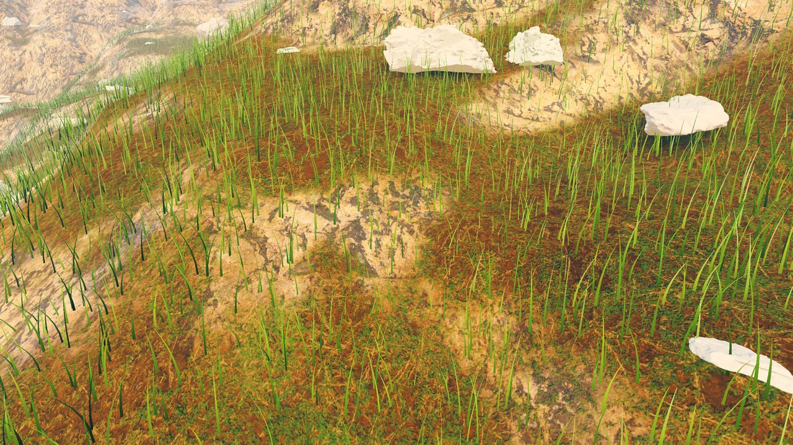

# Трава

## Что сделано

- Травинка — полоса из 5 сегментов, сужается к кончику. Один инстанс — одна травинка.
- Инстансы лежат в storage buffer, рисуются одним `vkCmdDrawIndexedIndirect`. Количество
  экземпляров считает GPU через `atomicAdd` в `instanceCount`, CPU его не читает.
- Размещение на GPU: сетка ячеек вокруг камеры, детерминированный хеш от мировых координат,
  высота из heightmap, биом по `layerHeights`, маска из `sparse_grass`.
- Отсечение: радиус вокруг камеры, frustum culling по ячейкам, плавное затухание плотности.
- Ветер: две бегущие волны, своя фаза у каждой травинки, основание закреплено, верх изгибается.
- Трава пишет albedo/normal/roughness в G-буфер и освещается общим deferred PBR. Тени от
  террейна и камней на траве работают.
- ImGui: плотность, высота, ширина, дальность, направление/сила/скорость ветра, depth prepass,
  frustum culling.



## Запуск

```bash
cmake -S . -B build -DCMAKE_BUILD_TYPE=Release
cmake --build build --target grass_task -j8
./build/tasks/grass/grass
```

Полезные флаги:

```
--no-grass | --no-grass-prepass | --grass-distance M | --grass-density D
--debug-view N | --camera fx fy fz tx ty tz | --screenshot out.png | --no-gui
```

## Замеры

Apple M3, 2560×1440, deferred, compact G-buffer:

| Параметр | Значение |
|---|---|
| Отрисовано | 33 633 травинки |
| Кандидатов | 1 465 472 |
| Placement (compute) | 0.10 мс |
| Прирост G-buffer | 0.41 мс |
| Итого | ≈ 0.5 мс |

Замеры — сравнение одного кадра с `--no-grass` и без него. Depth prepass для травы
включается, но на этой сцене медленнее, поэтому по умолчанию выключен.

## Ограничения

- Бонусная транслюсентность не сделана: в текущем G-буфере нет канала под тип материала.
  PBR-спекуляр и тени есть.
- Трава не пишется в карту теней, но получает тени от террейна и камней.
- Frustum culling по ячейкам, не по каждой травинке.
