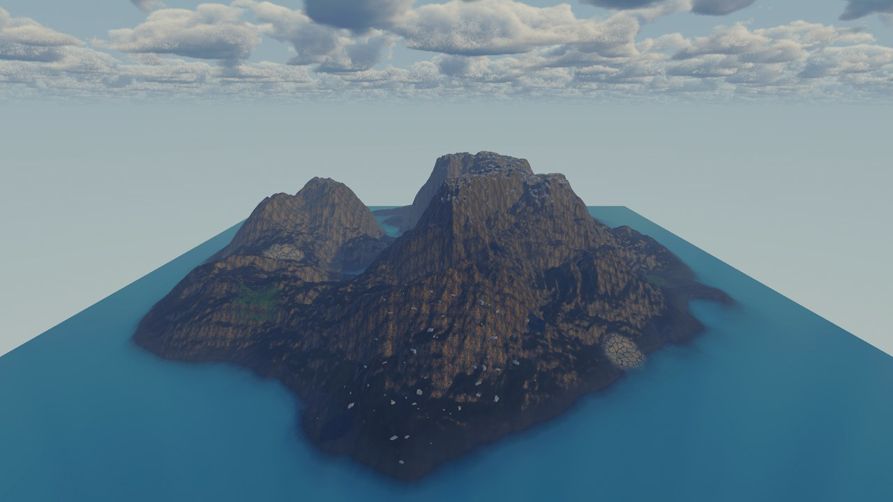

# Карта теней

## Что сделано

- Карта теней 4096×4096 `D32_SFLOAT` на весь террейн.
- Ортографическая матрица света строится по AABB террейна и выравнивается по текселям.
- Reversed-Z: очистка depth в 0, сравнение `GREATER`, bias прибавляется к опорной глубине.
- Террейн и камни рисуются в карту отдельным depth-only проходом.
- В deferred-освещении тень умножает только вклад солнца; ambient и небо не меняются.
- PCF 5×5, радиус настраивается (1–4 текселя).
- Bias: сдвиг вдоль нормали + slope-scaled depth bias, зависящий от `N·L`.
- Debug view «Sun shadow factor» показывает результат PCF.
- ImGui: включение теней, радиус PCF, normal offset, depth bias, тайминги.



## Запуск

```bash
cmake -S . -B build -DCMAKE_BUILD_TYPE=Release
cmake --build build --target shadowmap_task -j8
./build/tasks/shadowmap/shadowmap
```

Флаги:

```
--no-shadows | --pcf N | --shadow-bias M | --normal-bias M
--debug-view 10 | --screenshot out.png | --no-gui | --print-timings
```

## Замеры

Apple M3, 2560×1440, deferred, compact G-buffer, 4096² карта:

| Проход | Время |
|---|---|
| Shadow map | 2.1 мс |
| Lighting + PCF | 1.2 мс |

## Ограничения

- Одна карта на весь остров, без каскадов.
- Форвардный эталонный путь оставлен без теней.
- Трава получает тени от террейна и камней, но сама в карту не пишется.
